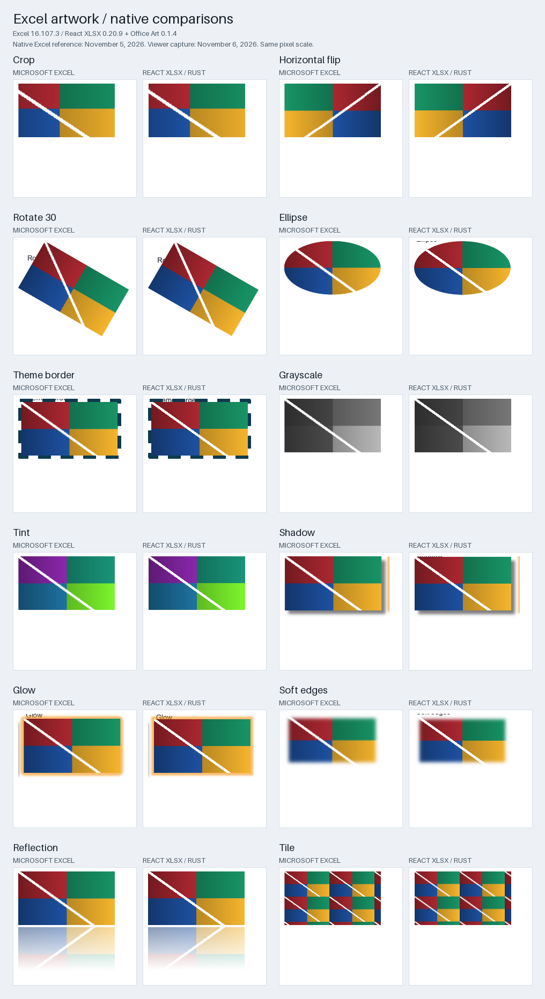
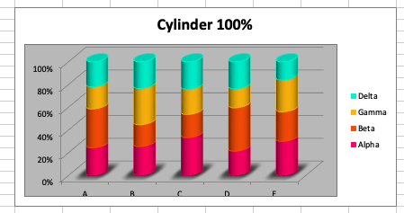
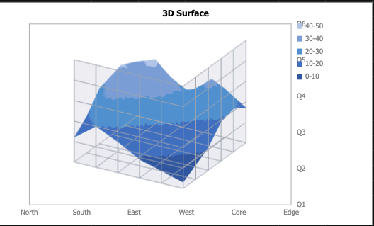
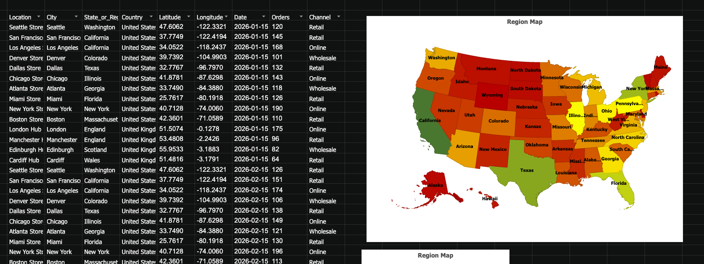
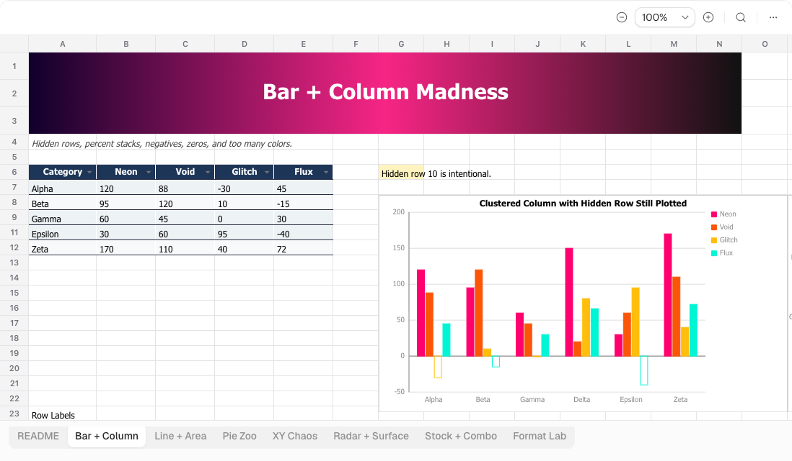
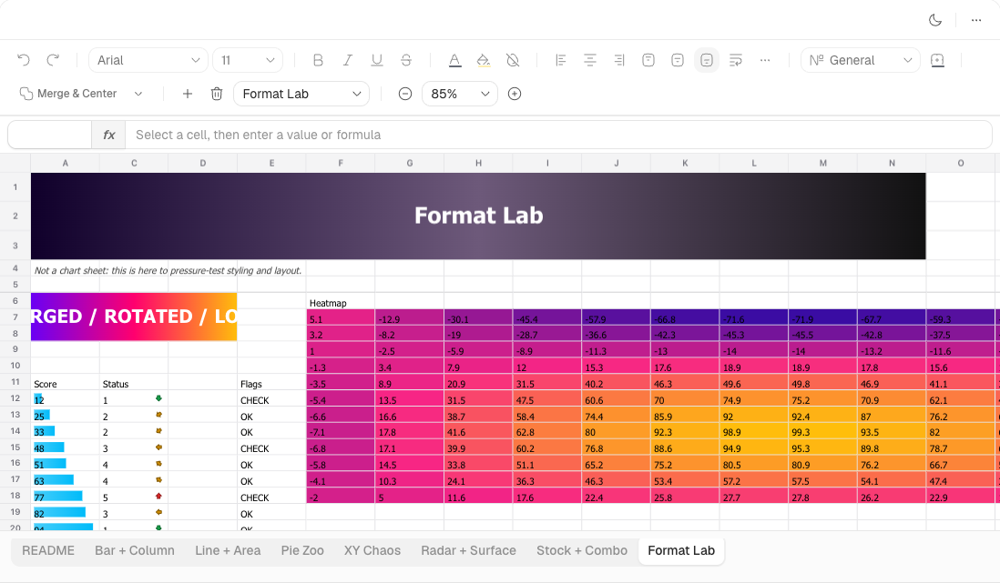

# react-xlsx

[](https://www.npmjs.com/package/@extend-ai/react-xlsx)
[](https://www.npmjs.com/package/@extend-ai/react-xlsx)
[](https://github.com/extend-hq/react-xlsx/releases)

JavaScript and React XLSX viewer/editor with worksheet rendering, charts, images, selection, formatting and export. DukeSheets handles workbook parsing/calculation; [Rust Office](https://github.com/extend-hq/rust-office) supplies chart and picture rendering.

## Quick start

```bash
pnpm add @extend-ai/react-xlsx
```

React integrations require `react` and `react-dom`; the `/vanilla` entry bundles Preact.

```tsx
import { XlsxViewer } from "@extend-ai/react-xlsx";

export function WorkbookViewer({ buffer }: { buffer: ArrayBuffer }) {
  return <XlsxViewer file={buffer} height={600} showDefaultToolbar readOnly />;
}
```

Use `XlsxViewerProvider` and `useXlsxViewer()` for custom controls. `readOnly={false}` enables editing; controller actions support undo/redo and `exportXlsx()`. Vanilla apps use `createXlsxViewer` from `@extend-ai/react-xlsx/vanilla` and call `destroy()` on teardown.

Use [`renderCellEditorOverlay`](./packages/react-xlsx/README.md#custom-cell-editor-overlays) for custom editor decoration, typing actions, and draft preview/keep/discard flows in React or vanilla JavaScript. The overlay is opt-in and appears only while editing.

[Full API and props](packages/react-xlsx/README.md) · [Vanilla API](packages/react-xlsx/README.md#vanilla-javascript) · [Hooks](packages/react-xlsx/README.md#useful-hooks)

## Integration notes

- WASM loads lazily. For custom hosting, call `setWasmSource` before parsing. Next.js Turbopack uses a public/CDN URL instead of `.wasm?url`; Vite development needs dependency exclusions. See [WASM and bundler setup](packages/react-xlsx/README.md#webassembly-asset).
- `.xlsx` is the primary format; `.xls` and `.xlsm` support is limited by DukeSheets and format-specific XML handling. The default file limit is 25 MB; configure `maxFileSizeBytes` for larger inputs.
- `setCellStyle`, `setSelectedCellStyle` and `setRangeStyle` persist formatting through undo/export. `getCellStyle` changes display only; the canvas renderer supports a subset of CSS. See [cell styling](packages/react-xlsx/README.md#persisted-cell-styling).
- Charts load on demand. Unsupported charts show explicit placeholders; map boundaries, native lighting and label placement have remaining gaps. [Chart loading](packages/react-xlsx/README.md#automatic-chart-loading) and [picture bindings](rust/office-art-wasm/README.md) document the rendering boundaries.

## Development

Use Node.js from [`.nvmrc`](.nvmrc) and pnpm 9.15.0; supported Node ranges are in [package.json](package.json).

```bash
pnpm install --frozen-lockfile
pnpm dev
pnpm build
pnpm typecheck
pnpm test
```

| Work | Start here |
| --- | --- |
| Public exports and types | [index.ts](packages/react-xlsx/src/index.ts), [types.ts](packages/react-xlsx/src/types.ts) |
| React wrapper and shared viewer | [react-viewer.tsx](packages/react-xlsx/src/react-viewer.tsx), [XlsxViewer.tsx](packages/react-xlsx/src/XlsxViewer.tsx) |
| Workbook state, edits and export | [controller.tsx](packages/react-xlsx/src/controller.tsx) |
| Parsing and worker loading | [wasm.ts](packages/react-xlsx/src/wasm.ts), [xlsx-worker.ts](packages/react-xlsx/src/xlsx-worker.ts) |
| Charts and picture rendering | [shared-chart.tsx](packages/react-xlsx/src/shared-chart.tsx), [picture-paint.ts](packages/react-xlsx/src/picture-paint.ts), [Rust adapter](rust/office-art-wasm) |
| Manual QA and releases | [apps/playground](apps/playground), [publish workflow](.github/workflows/publish.yml) |

Normal package builds verify the committed Office Art runtime. After adapter/dependency changes, run `pnpm build:office-art` with Rust, `wasm32-unknown-unknown` and `wasm-pack`; commit regenerated assets and provenance. Shared rendering fixes belong in Rust Office.

## Visual comparisons

### Microsoft Excel charts

[](https://github.com/extend-hq/rust-office/blob/7d8d3e2d13ae2076c5e4e23333f2f5725b67c85f/docs/excel-chart-comparisons.md)

November 5, 2026: **382 charts across 43 workbooks**, with **381 native Excel image pairs** and 48 gallery comparisons. These are retained captures; some captured font fallbacks were later removed. [Galleries, measurements and method](https://github.com/extend-hq/rust-office/blob/7d8d3e2d13ae2076c5e4e23333f2f5725b67c85f/docs/excel-chart-comparisons.md).

### Microsoft Excel pictures

[](docs/excel-art-comparisons.md)

November 6, 2026, React XLSX 0.20.9 / Office Art 0.1.4: **24 picture cases** against retained November 5 native references. Rasterization, effect edges and placement still differ; this does not establish coverage of all worksheet drawing types.

[Picture transforms](docs/readme-assets/excel-officeart-transforms.png) · [Picture effects](docs/readme-assets/excel-officeart-effects.png) · [All comparisons and capture method](docs/excel-art-comparisons.md)

### Chart gallery







### Live demos

[](https://www.extend.ai/ui/docs/components/xlsx-viewer)

[](https://www.extend.ai/ui/docs/components/xlsx-editor)

Click the screenshots for viewer/editor demos and integration docs. [MIT license](LICENSE).
