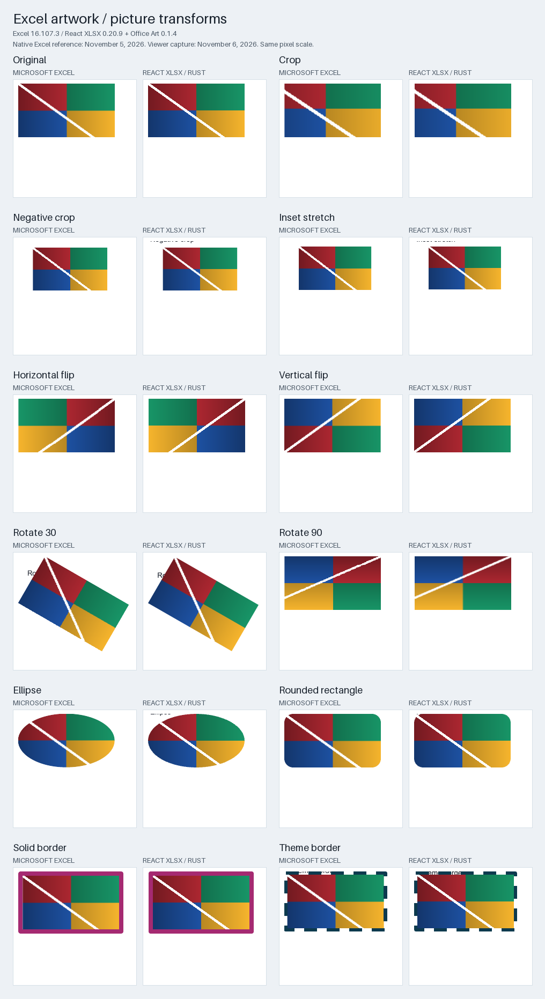
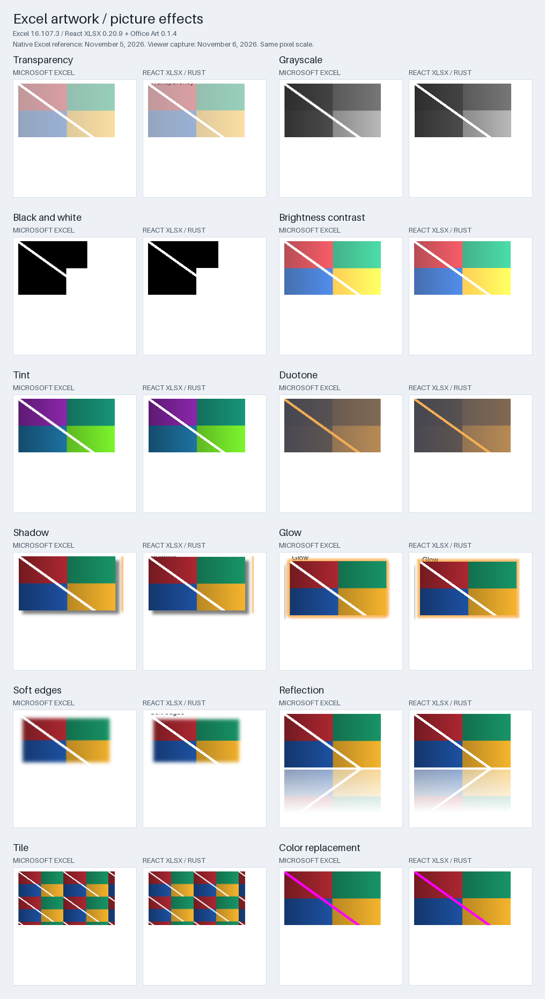

# Excel artwork comparisons

These 24 worksheet picture comparisons use Microsoft Excel for Mac 16.107.3 and React XLSX 0.20.9 with Office Art 0.1.4. The native Excel reference was captured on November 5, 2026; the viewer was recaptured on November 6, 2026. Excel appears on the left of every pair and React XLSX on the right.

The transform set covers the original image, crop, negative crop, inset stretch, horizontal and vertical flips, rotation, ellipse and rounded-rectangle clipping, and solid and theme-colored borders.

The effects set covers transparency, grayscale, black and white, brightness and contrast, tint, duotone, shadow, glow, soft edges, reflection, tile fill and color replacement.

## Capture method

The [synthetic workbook](readme-assets/excel-officeart.xlsx) was opened in Excel and exported to the retained [native PDF](readme-assets/excel-officeart-native.pdf). Poppler rasterized it at 96 DPI. Excel shape geometry, a fixed print-page offset of 50 points horizontally and 54 points vertically, and the renderer's paint bounds locate each reference crop.

The candidate images are Chromium 157.0.8103.38 screenshots of the actual picture elements mounted through the public vanilla viewer, with DOM rendering, editing enabled, worker loading disabled, 100% zoom and device pixel ratio 1. All 24 pictures loaded without viewer errors. One unmodified picture retains its original image source; the other 23 use generated Office Art output.

Both sides retain their captured pixels at the same scale. The gallery applies no independent resizing, image registration or color correction. Browser screenshot bounds can include an extra pixel when an element starts at a fractional coordinate. Expanded effect regions can contain neighboring worksheet labels, which remain visible.

[Capture provenance](readme-assets/excel-officeart-provenance.json) records the workbook, native PDF, page and candidate hashes, crop coordinates and renderer versions. [The gallery generator](../scripts/excel-art-gallery.py) composes the retained references and browser captures.

## Scope and visible differences

This gallery measures worksheet pictures and their decorations. It does not establish complete fidelity for arbitrary shapes, connectors, SmartArt, grouped drawings, text effects, ink or 3D models. Antialiasing, subpixel placement, clipping and effect edges still differ. There is no aggregate accuracy claim.

The [Excel chart galleries](https://github.com/extend-hq/rust-office/blob/7d8d3e2d13ae2076c5e4e23333f2f5725b67c85f/docs/excel-chart-comparisons.md) separately cover chart families, including 3D charts and chart effects.
